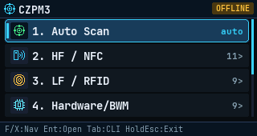
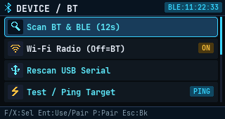
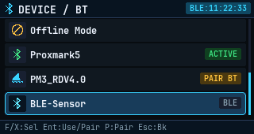
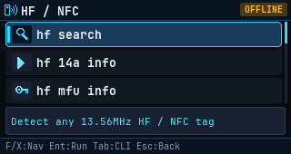
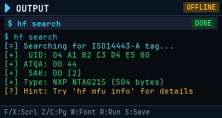
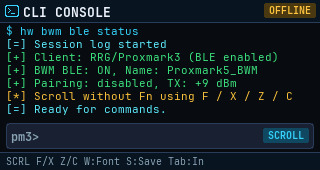

# CZPM3


Native ARM64 port of the **RfidResearchGroup Proxmark3** client paired with a lightweight **320×170** Linux framebuffer + keyboard GUI tailored for the **M5Stack CardputerZero** (`APPLaunch`).

Works over **USB serial**, **Proxmark5 BWM BLE (`ble:`)**, **RDV4 BlueShark Classic Bluetooth (`bt:`)**, and **Offline** mode.

> **Authorized use only:** CZPM3 is intended solely for authorized security research, testing, and work on RFID/NFC tags and hardware that you own or have explicit permission to assess.

## Screenshots

| Home | Device / BT | Classic BT & BLE |
|---|---|---|
|  |  |  |

| HF / NFC Menu | Output View | CLI Scroll Mode |
|---|---|---|
|  |  |  |

## Features

- **Readable 320×170 UI + Custom `14×14` Pixel Icons**: Scaled typography (`14 px` bold Home cards, `13 px` bold submenu titles, `11 px` output/CLI default) plus an instant `W` toggle between **Large (`11 px`)** and **Compact (`9 px`)** density for wide hex tables.
- **Proxmark5 BWM BLE (`ble:<MAC>`)**: Native BlueZ GATT backend with 4-mode non-blocking RX handling and tuned LE supervision timeouts for reliable multi-frame transfers (`lf t55xx dump`, `hf mf autopwn`) alongside active Wi-Fi.
- **RDV4 BlueShark Classic BT (`bt:<MAC>`)**:
  - Dual BR/EDR + BLE scanning (`Scan BT & BLE (12s)`), non-root `PIN 1234` pairing (`Enter` on unpaired BT or `P`), RFCOMM connect retries, and `500 ms` read timeouts.
  - **Automatic Wi-Fi Coexistence**: CardputerZero's onboard `CYW4343A2` (`btc_mode=0`) shares a single 2.4 GHz radio between Wi-Fi and Classic BT. CZPM3 automatically pauses Wi-Fi (`nmcli radio wifi off`) during `bt:` pairing/sessions and restores Wi-Fi when switching to BLE/USB/Offline or exiting (also toggleable manually via `Wi-Fi Radio (Off=BT)` in `Device / BT`).
- **Persistent Proxmark3 Session**: `forkpty()` session management with automatic reconnect, status badges (`DONE`/`WARN`/`ERR`), graceful `Enter`/`Esc` stop for `hf tune` / `lf tune`, `Ctrl+C` hard abort, persistent CLI history (`~/.config/czpm3/history.txt`), and Saved Dumps viewer (`~/pm3-dumps/`).
- **CardputerZero Navigation & Low Overhead**: Uses `F` / `X` / `Z` / `C` (matching APPLaunch without holding `Fn`), event-driven `poll()` loop with cached ASCII glyphs (`0.000%` idle CPU, ~5.3 MB RSS).

## Quick Install (CardputerZero / Trixie `arm64`)

Download `czpm3_1.4.1_arm64.deb` from the [GitHub Releases](https://github.com/MrBoogus/czpm3/releases) page and install:

```bash
sudo dpkg -i czpm3_1.4.1_arm64.deb
sudo apt-get install -f   # only if any shared dependencies are missing
```

Restart APPLaunch (or reboot) to show **CZPM3** in the CardputerZero launcher:

```bash
systemctl --user restart APPLaunch.service
```

> **Note:** The package sets `/usr/bin/proxmark3` to group `bluetooth` (`0750`) with `cap_net_raw,cap_net_admin+ep` via `postinst` so members of the `bluetooth` group can use BLE/BT connections without running the GUI as root.

## Wi-Fi Pause & Recovery

CardputerZero's onboard `CYW4343A2` (`btc_mode=0`) shares a single 2.4 GHz radio between Wi-Fi and Classic Bluetooth. To keep `bt:` RFCOMM connections stable:

- **Automatic pause:** Before pairing or connecting over `bt:`, CZPM3 runs `nmcli radio wifi off` and writes a marker file at `~/.config/czpm3/wifi_paused`.
- **Automatic restore:** Wi-Fi is re-enabled and `~/.config/czpm3/wifi_paused` is removed when switching to BLE/USB/Offline or exiting CZPM3 cleanly.
- **Crash or manual recovery:**
  - **Next launch:** At startup, if `~/.config/czpm3/wifi_paused` exists, CZPM3 automatically runs `nmcli radio wifi on` and deletes the marker.
  - **In the UI:** Select **Restore Wi-Fi** in the **Device / BT** menu.
  - **From a shell:** Run:
    ```bash
    nmcli radio wifi on && rm -f ~/.config/czpm3/wifi_paused
    ```

## Controls

| Key | Action |
|---|---|
| `↑` / `↓` or `F` / `X` | Navigate menus / scroll output (without holding `Fn`) |
| `←` / `→` or `Z` / `C` | Page Up / Page Down in Scroll & Output views |
| `Enter` | Open menu / run command / connect or pair BT / stop `tune` loop |
| `P` *(on BT row in Device/BT)* | Pair & trust Classic BT device (PIN `1234`) |
| `W` *(Output / CLI Scroll)* | Toggle Large (`11 px`) ↔ Compact (`9 px`) text density |
| `Tab` | Switch to CLI Console / toggle CLI Input ↔ Scroll mode |
| `Esc` *(short press)* | Back one screen / stop active command (press twice to abort) |
| `Esc` *(hold ≥ 800 ms)* | Exit CZPM3 cleanly back to APPLaunch |
| `Q` *(on Home screen)* | Exit application |
| `r` *(Output / Dumps)* | Re-run last command / refresh dumps list |
| `s` *(Output / CLI Scroll)* | Save current output log to `~/pm3-dumps/` |
| `Ctrl+U` / `Ctrl+L` *(CLI)* | Clear input line / clear output buffer |

## Building from Source (on CardputerZero)

Install build dependencies (`build-essential`, `libfreetype-dev`, `libpng-dev`, `libbluetooth-dev`, plus standard Proxmark3 build deps):

1. Clone `RfidResearchGroup/proxmark3`, check out the tested upstream commit (`da929f9`), and apply [`patches/pm3-ble-cpz.patch`](patches/pm3-ble-cpz.patch):
   ```bash
   git clone https://github.com/RfidResearchGroup/proxmark3.git
   cd proxmark3
   git checkout da929f9
   git apply /path/to/czpm3/patches/pm3-ble-cpz.patch
   make -j4 SKIPQT=1 SKIPGD=1 SKIPPYTHON=1 PREFIX=/usr client
   ```
2. Build the CZPM3 GUI:
   ```bash
   cd /path/to/czpm3
   make -C src -j4
   ```
3. Build the `.deb` package:
   ```bash
   PM3_DIR=/path/to/proxmark3 ./packaging/build-deb.sh
   sudo dpkg -i dist/czpm3_1.4.1_arm64.deb
   ```

## Credits & License

- Proxmark3 client & firmware ecosystem: [RfidResearchGroup/proxmark3](https://github.com/RfidResearchGroup/proxmark3)
- Target hardware & launcher: M5Stack CardputerZero (`APPLaunch`)
- Licensed under **GNU GPL v3.0** — see [LICENSE](LICENSE).
